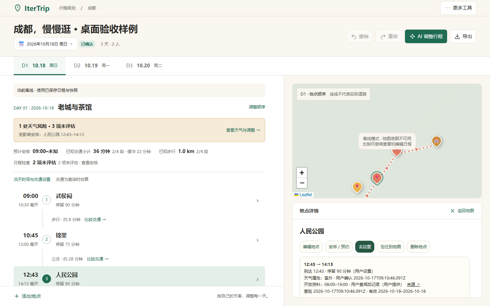
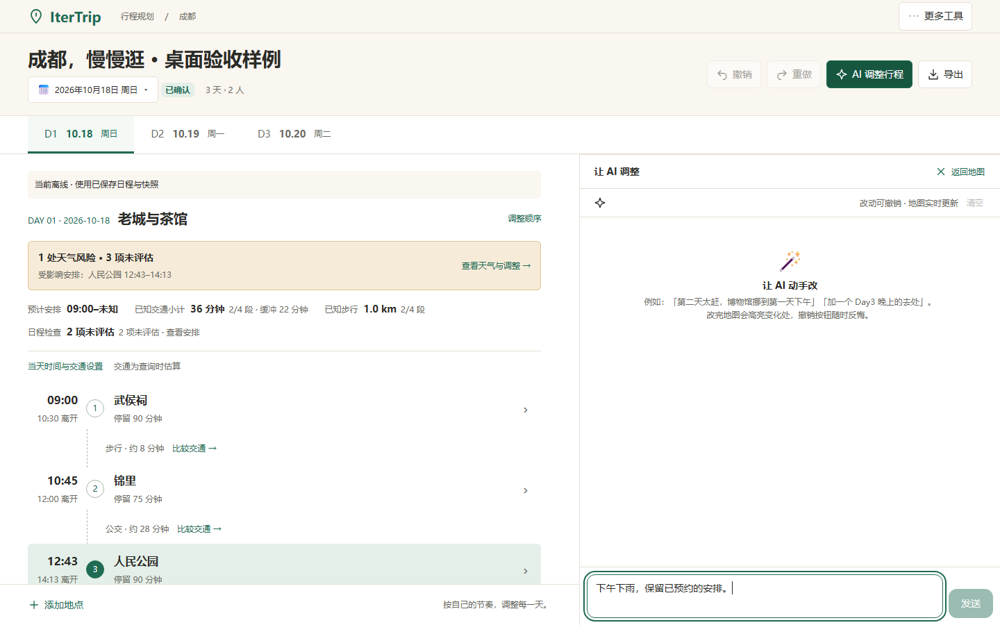

# M31 后续：A 行程布局与现有配色

2026-10-17，已实现并本地验证。

## 结果

保留米白、墨绿和暖金，正式桌面规划页采用 A 的宽幅当天行程。>=1280px 为约 58% / 42% 两列，1024–1279px 为 56% / 44%。左侧连续呈现当天主题、天气问题、已知／未知摘要、地点与交通、住宿；编辑、预约和导航在选中详情，拖拽、上下移动与跨天选择通过“调整顺序”进入。

右侧默认显示真实地图，选择地点后分为上方地图和下方可滚动详情。AI、天气、交通比较、当天设置、地图设置和离线管理在右侧整区切换。左侧始终可见；AI 输入、对话、生成和待确认预览保留，关闭不等于停止。关闭工具恢复地图；地图保持同一实例，沿用 ResizeObserver 更新尺寸并保留缩放。

桌面地图使用选中图钉高亮，完整地点信息进入旁边详情，避免地图气泡重复占据小地图。手机保持原气泡与导航入口。新增／重新选点会切回地图。底图离线提示相对地图容器居中，说明可继续编辑日程。

## 实现边界

- 业务状态和操作仍由 Plan 管理；复用日程、交通、天气、Agent、表单、导航和撤销逻辑。
- 仅增加桌面展示与地图选中键等前端内部接口；后端 API、RouteJSON、存储格式和历史栈不变。
- 首页、手机出行界面与导出布局保留原行为；未添加运行时依赖、UI 框架或在线字体。
- [配色深化草图](design/desktop/research-2026-10/design-demos/a-cream-workspace.html) 明确采用示例数据与路线示意，不作为正式旅行数据来源。

## 验证

| 验证 | 结果 |
|---|---|
| TypeScript + Vite 生产构建 | 通过；JS gzip 约 222.30 kB，保留已有大 chunk 提示 |
| M31 React DOM | 两列、按需排序、跨天移动／删除／撤销／重做、地图高亮与单实例、交通只读选择、受控天气、AI 输入保留、表单／导航、手机断点与观察器清理通过 |
| M29 / M30 新桌面 DOM | 天气候选和属性编辑、Agent 原子预览／取消／确认、旧结果拒绝、独立停止、关闭后继续生成、单次撤销与持久化通过 |
| M25 / M26 / M27 / M29 / M30 旧界面 DOM | 导航、交通、预约、天气和 Agent 兼容回归通过 |
| M29 / M30 领域检查 | 天气边界与未知条件、35 个 Agent 场景通过 |
| M28 worker / 生产 DOM | 缓存、离线冷启动、修改与撤销、失败查询保留、出行进度和显式更新通过 |
| 实际 Edge 浏览器 | 使用本次生产 JS/CSS、隔离浏览器上下文和合成行程；四种尺寸无横向溢出或页面异常，真实编辑保存／撤销、Escape 及焦点返回通过 |

浏览器检查尺寸：1024×768、1280×800、1440×900、1920×1080。四种尺寸实际行程列宽分别约 573、742、835、1114px；选择地点后地图区高度约 272、282、337、436px，详情位于下方独立滚动。检查了长名称、预约冲突、未知交通、天气风险、无酒店和空白天。截图已逐张查看。





## 复现与证据边界

在 frontend 下执行：

```powershell
npm run build
node scripts/m31-dom.mjs
$env:M31_DESKTOP='1'
node scripts/m29-dom.mjs
node scripts/m30-dom.mjs
node scripts/m28-dom.mjs
node scripts/desktop-a-browser.mjs
```

浏览器脚本使用已安装的全局 Puppeteer 和本机 Edge；可通过 PUPPETEER_PATH 指定模块目录。它把当前生产构建内联进独立本地验收文件，在隔离上下文中设置合成行程，拦截外部网络，实际 API 请求为 0；原始截图和尺寸报告位于 frontend/test-artifacts/desktop-a，不入库。精选截图存于本记录的设计验收目录。

本次真实浏览器验证覆盖排版与本地交互，没有调用真实 LLM、交通或天气服务；底图故意离线，截图中的灰色底图是明确降级状态。实际部署后的底图加载、外部导航唤起及模型供应商连通性不属于这次离线浏览器证据。已有业务回归与浏览器视觉证据分别记录，未互相替代。
