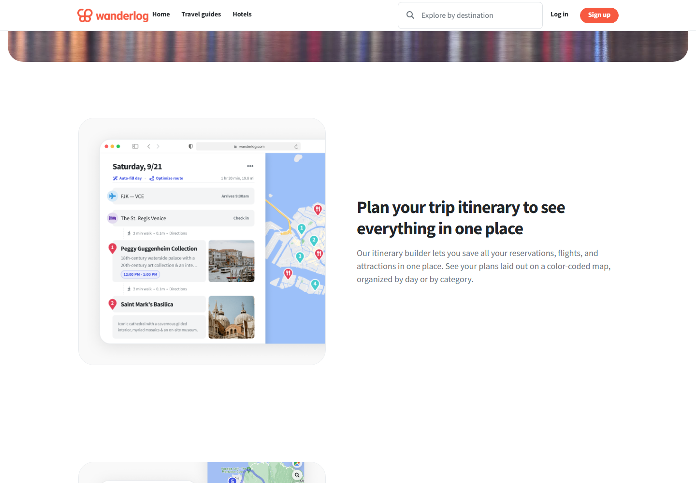
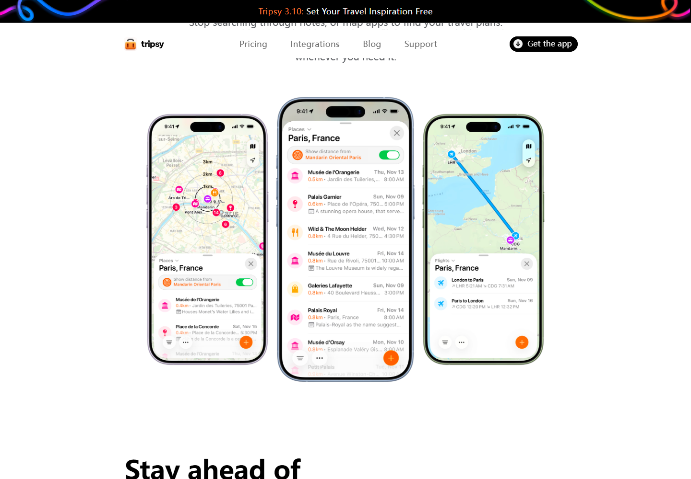
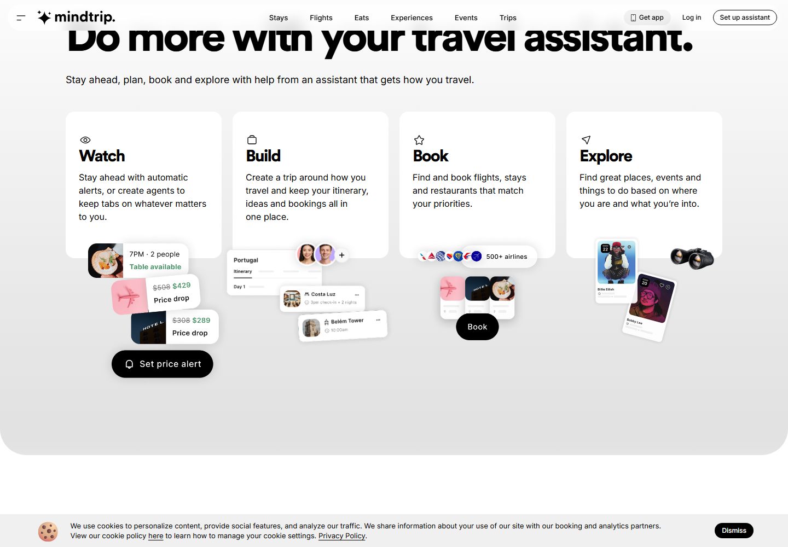

# 已查看的公开界面素材

2026-10-05，公开网页只读访问与浏览器渲染截图；版权归对应产品所有。仅用于本项目的布局调研，未复制图片到 IterTrip 草图中。官网素材不等于本次登录实测。

## Wanderlog：桌面行程与地图

[原页面](https://wanderlog.com/plan-a-trip)。本次截图展示官网的行程编辑器素材：日期在上、住宿与地点按顺序排列、两站之间有耗时、右侧地图编号。可借鉴交通与地点的直接关系。

## Tripsy：手机地图与地点列表

[原页面](https://tripsy.app/)。这是手机展示，不是桌面编辑器截图。主名称、日期时间、分类图标与备注有区别；地图和列表接在一起。这里只借鉴信息层级。

## Mindtrip：官网简化行程组件

[原页面](https://mindtrip.ai/)。Build 区域展示按天的行程小组件，不能从它推断完整编辑页。助手、行程、预订、探索分别用具体结果表达。

## 未取得实际界面的参考

- Roadtrippers：浏览器打开官方帮助页面停在安全验证，未绕过；调研采用网页检索工具取得的官方帮助文字。
- 千问：官方发布说明证明旅行与导航能力；本次没有实际进入其旅行编辑界面。
- Tripsy Web：官方页面说明当前主要在线查看，完整网页编辑仍在候补阶段。

以上未取得界面的部分不作为像素、字体或编辑手感评价依据。
